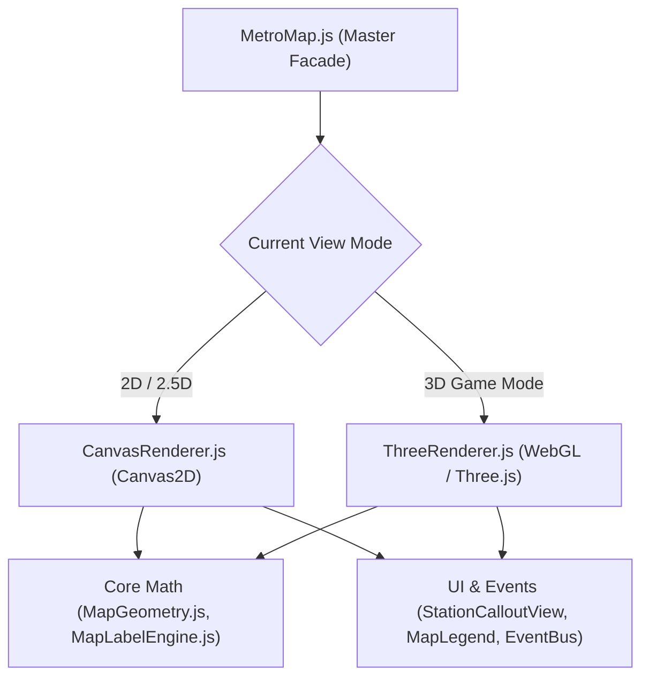

# 🏛️ 3D Metro Map Engine - Architectural Blueprint & Design System

> **Location:** `doc/3d_map_doc/ARCHITECTURE_3D.md`  
> **Target:** Architecture design for integrating the Pure 3D CoC-inspired WebGL Engine alongside 2D/2.5D Canvas.

---

## 1. Modular Integration Strategy

The 3D map engine plugs into the existing architecture through the **Renderer Strategy Pattern**:

---

## 2. 3D Sub-Modules Breakdown (`main_project/js/components/map/three/`)

| Module | Responsibility |
| :--- | :--- |
| **`ThreeRenderer.js`** | Manages `THREE.Scene`, `THREE.PerspectiveCamera`, WebGL renderer, shadow maps, and resize lifecycle. |
| **`ThreeGroundTerrain.js`** | Procedural base ground ($Z = 0$) + dynamic cut-away trenches with rocky borders for subterranean stations. |
| **`ThreeTrackBuilder.js`** | Generates dynamic 3D rails and Bézier ramps from station coordinates via `CatmullRomCurve3` / `TubeGeometry`. |
| **`ThreeAssetManager.js`** | Loads, caches, and clones `.glb` models; handles `THREE.InstancedMesh` for high-performance pillar rendering. |
| **`ThreeInteraction.js`** | Raycaster for station hovering, clicks, and camera orbit controls (OrbitControls customized for transit limits). |
| **`ThreeBadgeOverlay.js`** | 3D CoC-style wooden/metal station banners rendered as billboard sprites or lightweight 3D meshes. |

---

## 3. Visual Styling & Shader Aesthetics (CoC Theme)

1. **Camera Angle**: Isometric inclination ($35^\circ$ to $45^\circ$ pitch) with full orbit capabilities.
2. **Lighting**:
   - **Directional Sunlight**: Warm golden-white sunlight ($135^\circ$) casting soft percentage-closer soft shadows (PCFSoftShadowMap).
   - **Hemisphere Ambient Light**: Sky color (soft light blue) + Ground color (warm earthen sand) for vibrant game atmosphere.
3. **Materials**:
   - Stylized Toon / Cel-shaded material (`THREE.MeshToonMaterial`) with custom gradient maps for cartoon strategy game feel.
   - Ground: Warm sandy earthen tint matching the reference image.
   - Cut-away Walls: Rough stone/rock texture or earthen block segments.
