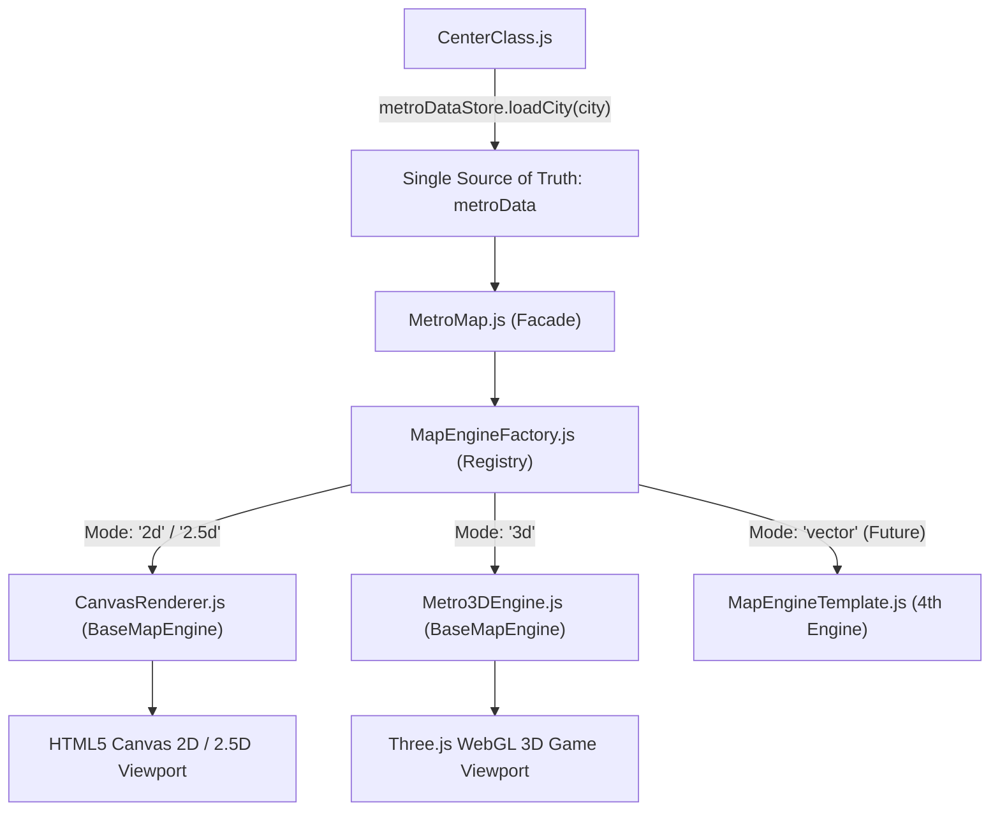

# 🏛️ 3D Metro Map Engine - Architectural Blueprint & Design System

> **Location:** `doc/3d_map_doc/ARCHITECTURE_3D.md`  
> **Status:** Production Pluggable Architecture (100% Real Transit Data Connected)  
> **Master Reference:** [`MAP_DATA_FLOW_CLASS_AND_EXTENSION_ARCHITECTURE.md`](./MAP_DATA_FLOW_CLASS_AND_EXTENSION_ARCHITECTURE.md)

---

## 1. Modular Pluggable Integration Strategy

The 3D map engine integrates into the metro application via the **Pluggable Factory + Strategy Pattern**:



---

## 2. 3D Sub-Modules Breakdown (`main_project/js/components/map/three/`)

| Module | Responsibility |
| :--- | :--- |
| **`Metro3DEngine.js`** | Core 3D orchestrator inheriting from `BaseMapEngine`. Manages `THREE.Scene`, `THREE.PerspectiveCamera`, WebGL renderer, real Lat/Lon spline projection, and render loop. |
| **`ThreeGroundTerrain.js`** | Procedural base ground ($Z = 0$) + warm sandy terrain + dynamic cut-away trenches with rocky borders for subterranean stations. |
| **`ThreeCoCTrack.js`** | Generates dynamic 3D rails and Bézier ramps from real station coordinates via `CatmullRomCurve3` / `TubeGeometry`. |
| **`ThreeViaductBridge.js`** | Creates elevated stone viaducts and loads 3D support pillars (`piller.glb`) under aerial tracks. |
| **`ThreeStationBuilder.js`** | Procedural elevated canopy stations with 5 distinct architectural styles. |
| **`ThreeUndergroundStationBuilder.js`** | Open-cut underground station platform models with glass shades. |
| **`ThreeTrainController.js`** | Low-poly metro train model moving smoothly along 3D splines with bogie articulation. |

---

## 3. Real Transit Data Pipeline

`Metro3DEngine` accepts the standardized `metroData` object generated by `metroDataStore`:

1. **Station Lat/Lon to 3D Space:**
   $$\Delta \text{lon} = \text{lon} - \text{centerLon}, \quad \Delta \text{lat} = \text{lat} - \text{centerLat}$$
   $$X_{3d} = \Delta \text{lon} \times 111.32 \times \cos(\text{centerLat}) \times \text{scale}$$
   $$Z_{3d} = -\Delta \text{lat} \times 110.57 \times \text{scale}$$

2. **Line Spline Generation:**
   Stations ordered sequentially per line are converted into `THREE.Vector3` control points. A smooth 3D curve is built using:
   ```javascript
   const curve = new THREE.CatmullRomCurve3(points, false, 'catmullrom', 0.2);
   ```

3. **Elevation Levels:**
   - **Underground Stations:** Positioned at $Y = -4.0$ to $-6.0$.
   - **At-grade Stations:** Positioned at $Y = 0.0$.
   - **Elevated Viaduct Stations:** Positioned at $Y = +5.2$ with support pillars below.

---

## 4. Visual Styling & Shader Aesthetics (CoC Theme)

1. **Camera Angle:** Isometric inclination ($40^\circ$ pitch) with full orbit damping via `OrbitControls`.
2. **Lighting:**
   - **Directional Sunlight:** Warm golden-white sunlight ($135^\circ$) casting soft percentage-closer soft shadows (`PCFSoftShadowMap`).
   - **Hemisphere Ambient Light:** Warm CoC parchment/desert tone background (`#e8d6b5`) with subtle exponential fog (`FogExp2`).
3. **Materials:**
   - Stylized Toon & Standard materials with tuned roughness/metalness for a vibrant strategy game atmosphere.
   - Preserves native line colors (Red, Blue, Yellow, Violet, Magenta, etc.) for distinct visual identity.

---

## 5. UI Controls & Platform Synchronization

- **Top-Right Switcher (`#viewModeWidget`):** Smooth animated 3-state slider (`[2D] [2.5D] [3D]`). Preserved across engine switches without DOM destruction.
- **Top-Right Fullscreen (`#btnToggleMapFullscreen`):** Toggles map into fullscreen with SVG icons (`maximize-solid-full.svg` ⟷ `minimize-solid-full.svg`).
- **Capacitor Android APK Support:** Automatically applies header safe-area spacing in native APKs (`body.is-capacitor-app`) to avoid overlapping the camera notch/status bar.
