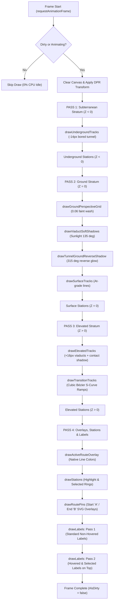

# 🚇 Metro Map Architecture & Technical Reference Manual

> **File Location:** `doc/Map_ARCHITECTURE.md`  
> **Status:** Fully Modular, High-Performance Canvas Engine (Zero Dead Code, 100% Production Ready)  
> **Target:** Developers and AI Coding Agents maintaining or extending the map system.

---

## 1. Executive Architecture Overview

The Metro Map component in this application is a **high-performance, hardware-accelerated HTML5 Canvas rendering engine** capable of rendering complex metro networks (from small networks like Agra Metro with 6 stations to massive networks like Delhi NCR with 250+ stations) at **60–120 FPS**.

### Key Architectural Pillars:
1. **Fully Modular Architecture**: The monolithic rendering code has been divided into single-responsibility ES6 modules under `main_project/js/components/map/`.
2. **Dual-Mode Visualization**:
   - **2D Mode**: Clean schematic transit map with geographic proportionality and SVG-quality clarity.
   - **2.5D Mode**: 3D Isometric/Perspective tilted projection with full 360° camera orbit, elevation strata (+Z aerial viaducts, -Z subterranean tunnels), and sunlight-angle soft shadows.
3. **Zero Dead Code & Pure Engine**: 100% free of legacy SVG DOM manipulation, orphaned CSS rules, duplicate lifecycle methods, or intermediate compatibility facades.
4. **Natural Cubic Bézier S-Curve Transitions**: Multi-level track connections (e.g., underground to elevated ramps) use 3D Cubic Bézier curves with horizontal entry/exit tangents, eliminating sharp knife-edge V-notches.
5. **Native Color Active Routes**: Active routes render 100% in their native line colors (Orange, Blue, Yellow, etc.) without distracting white/blue overlay ribbons, supporting interactive "Clear Route" ⟷ "Show Route" toggling.
6. **Responsive Overlay Synchronization**: Floating widgets (`#viewModeWidget`, `#map25DControlsPanel`, `.alarm-widget-wrapper`, `#zoomControls`) seamlessly auto-hide with synchronized transitions whenever desktop sidebars or mobile bottom drawers/legends open.

---

## 2. Directory Structure & Module Responsibilities

All map-related files reside under `main_project/js/components/map/`:

```
main_project/js/components/map/
├── MetroMap.js                       # Unified Facade component (bridges CenterClass, UI, & Legend)
├── core/                             # Pure Mathematical & Coordinate Logic
│   ├── MapGeometry.js                # Lat/Lon to Canvas coordinate projection, ViewBox & Zoom bounds
│   └── MapLabelEngine.js             # High-performance multi-line text wrapping & hyphenation
├── canvas/                           # HTML5 2D / 2.5D Canvas Pipeline
│   ├── CanvasRenderer.js             # Core canvas orchestrator, station glyphs & 2-pass labels
│   ├── CanvasGestures.js             # 120 FPS Pan, Pinch-Zoom, Wheel, 3D Orbit & Hover Controller
│   ├── CanvasCamera3D.js             # 360° Yaw/Pitch Matrix, 3D Perspective Divide, Elevation & Shadows
│   └── CanvasTrackRenderer.js        # Multi-stratum track pipeline, Bézier ramps, viaduct & tunnel shadows
└── ui/                               # Interactive Overlays & Controls
    ├── MapLegend.js                  # Interactive legend UI, 5 structural layouts, 5 network statuses
    └── StationCalloutView.js         # Interactive Map Station Popup & Route Drafting Component
```

### Supporting Styling Files:
- `main_project/css/components/map_styling.css` — 2D/2.5D slider widget, view settings toggle, 2.5D camera control sliders, callout popups, and zoom controls (100% purged of dead SVG rules).
- `main_project/css/components/legend_panel.css` — Multi-section legend panel (Physical Layout, Network Status, Line Toggles).
- `main_project/css/pages/index.css` — Global & mobile overlay synchronization rules.

---

## 3. Detailed Component Breakdown

### 3.1 `MetroMap.js` (Component Facade)
- **Role**: Acts as the single entry point for `CenterClass.js` and UI controllers.
- **Responsibilities**:
  - Instantiates `CanvasRenderer` inside `.mapContainer`.
  - Instantiates `MapLegend` and wires mutual filtering events via `eventBus`.
  - Renders top-right view switcher (`#viewModeWidget`) and 2.5D controls panel (`#map25DControlsPanel`).
  - Exposes public APIs: `setZoom()`, `zoomIn()`, `zoomOut()`, `fitToScreen()`, `highlightRoute()`, `toggleRouteVisibility()`, `clearRoute()`, `setTheme()`, `setLanguage()`.
  - Dispatches station click and hover events to `CenterClass`.

### 3.2 `CanvasRenderer.js` (Main Orchestrator)
- **Role**: The central canvas engine and pass coordinator.
- **Responsibilities**:
  - Initializes the canvas element with `{ alpha: true }`, `touchAction: "none"`, and high-DPI scaling (`dpr = Math.min(window.devicePixelRatio || 1, 2)`).
  - Manages the dirty-check 120 FPS render loop (`requestAnimationFrame`). Idle CPU usage is **0%**.
  - Renders **Station Glyphs** supporting 5 legend types:
    1. Normal Station (Clean Cream Circle `#FDFBD4` with Line Color Border)
    2. Interchange Station (Double Concentric Ring with Outer Contrast Border)
    3. Walkway Interconnection (Subtle Dashed Connector)
    4. Multimodal Hub (Intercity Railway / Bus interchange glyphs)
    5. Shared-Track Segment Stations
  - Renders **2-Pass Station Labels**: Standard labels render first; hovered and selected labels render on top with crisp haloes.
  - Manages route visibility state (`#isRouteVisible`) for seamless toggle without re-running Dijkstra pathfinding.

### 3.3 `CanvasGestures.js` (Interaction & Touch Controller)
- **Role**: High-performance interaction engine decoupled from drawing logic.
- **Responsibilities**:
  - **Left-Click Drag**: Smooth map panning.
  - **Right-Click / Shift + Drag (2.5D)**: 360° camera orbit rotation (Bearing) and vertical tilt (Pitch).
  - **Mouse Wheel**: Cursor-centered zoom (`zoomToPoint`).
  - **Mobile Touch**:
    - 1 finger: Smooth drag and pan.
    - 2 fingers: Pinch-to-zoom centered at the midpoint of both fingers.
  - **Hover Detection**: Dynamically calculates closest station within `minDistance = Math.max(14, Math.min(24, 16 * Math.sqrt(zoom)))` and drives smooth 120 FPS cross-fade transitions.
  - **Memory Cleanliness**: All window/canvas event listeners are tracked via `AbortController` for leak-free teardown in `destroy()`.

### 3.4 `CanvasCamera3D.js` (3D Matrix & Perspective Engine)
- **Role**: Dedicated 3D mathematical transformation engine.
- **Responsibilities**:
  - **3D Rotation Matrix**: Computes 360° Yaw rotation around the Z-axis and Pitch tilt around the X-axis:
    $$\begin{aligned}
    rx &= dx \cos(\text{rot}) - dy \sin(\text{rot}) \\
    ry &= dx \sin(\text{rot}) + dy \cos(\text{rot}) \\
    y_{3d} &= ry \cos(\text{pitch}) - z \sin(\text{pitch}) \\
    z_{3d} &= ry \sin(\text{pitch}) + z \cos(\text{pitch})
    \end{aligned}$$
  - **Perspective Divide**:
    $$\text{perspective} = \text{clamp}\left(0.2, 2.5, \frac{\text{cameraDist}}{\max(40, \text{cameraDist} - z_{3d})}\right)$$
  - **Normalized Layout Elevation Levels**:
    - `elevated`: $+16\text{px}$ (+25m flyover viaduct)
    - `multi_level`: $+60\text{px}$ (stacked multi-tier hub)
    - `at-grade` / surface: $0\text{px}$ (ground datum)
    - `cut_and_cover`: $-6.3\text{px}$ (shallow box excavation)
    - `underground`: $-14\text{px}$ (-20m subterranean bored tunnel)
  - **Dynamic Relative Shadow Scaling**:
    - Projects shadows with distance scaling proportionally to zoom:
      $$\text{zoomScaleFactor} = \text{zoom}^{0.82}$$
    - `projectSunShadow(x, y, z)`: Projects elevated viaducts along sunlight angle ($135^\circ$) onto ground plane ($Z = 0$).
    - `projectTunnelReverseShadow(x, y, z)`: Projects subterranean conduits along reverse angle ($315^\circ$, $+180^\circ$) onto $Z = 0$.

### 3.5 `CanvasTrackRenderer.js` (Multi-Stratum Track Pipeline)
- **Role**: Specialized track drawer supporting all visual strata with zero parallel ghost lines.
- **Responsibilities**:
  - `drawUndergroundTracks`: Subterranean bored tunnel tracks rendered cleanly at negative elevation ($Z < 0$).
  - `drawSurfaceTracks`: Clean at-grade tracks at $Z = 0$.
  - `drawElevatedTracks`: Aerial flyover viaducts with subtle contact drop shadows directly beneath tracks (no separated parallel line clutter).
  - `drawTransitionTracks`: Smooth inclined Cubic Bézier S-curve ramps connecting underground and elevated sections without V-notches.
  - `drawActiveRouteOverlay`: Emphasizes active route in native line colors (Orange, Blue, etc.) with 100% path clarity.
  - `strokeTrackSegment`: Applies line colors and dashed stroke patterns for `under_construction` (amber dash) and `approved` (blue dot) lines.

### 3.6 `MapGeometry.js` (Pure Coordinate & ViewBox Math)
- **Role**: Pure mathematical utility with zero DOM/Canvas dependencies.
- **Responsibilities**:
  - `convertLatLonToXY`: Projects latitude/longitude to flat Cartesian space using equirectangular projection centered at network latitude.
  - `calculateViewBox`: Determines network bounding box, width, height, and dynamic safety margins.
  - `calculateZoomRange`: Calculates optimal min/max zoom based on geographic span.
  - `precalculateLabelGeometry`: Analyzes neighbor tracks for every station to pre-compute primary angle orientation (horizontal, vertical, diagonal NW-SE, diagonal NE-SW) and junction quad.

### 3.7 `MapLabelEngine.js` (Word-Wrapping Utility)
- **Role**: High-efficiency station label text wrapping.
- **Responsibilities**:
  - `getWrappedLines`: Wraps multi-word station names (e.g. "Kashmere Gate", "Shaheed Sthal (New Bus Adda)") to prevent excessively wide single-line collision boxes.

### 3.8 `MapLegend.js` (Interactive Legend Component)
- **Role**: Manages the collapsible legend panel and interactive filter states.
- **Responsibilities**:
  - Renders physical structure legend: Elevated, Underground, At-Grade, Cut & Cover, Multi-Level.
  - Renders operational network status legend: Operational, Under Construction, Planned / Approved, Temporarily Closed, Decommissioned.
  - Emits filter events to `MetroMap` to dim non-matching tracks and stations (`alpha: 0.22`) while keeping matching elements fully vibrant (`alpha: 1.0`).
  - Manages `[✕ Clear Route]` ⟷ `[👁️ Show Route]` button toggle UI.

### 3.9 `StationCalloutView.js` (Interactive Popup)
- **Role**: Interactive station info card and route drafting popup.
- **Responsibilities**:
  - Renders station metadata (Line badges, Layout, Status, Fare info).
  - Provides quick "From Here" / "To Here" route selection.
  - Single clean `destroy()` lifecycle method cleaning animation frames, resize listeners, and transform subscriptions.

---

## 4. Render Pass Execution Order (Per Frame)

When `requestAnimationFrame` fires (only when dirty or animating), `CanvasRenderer` executes 4 distinct visual strata passes:



---

## 5. Mobile & Touch Engine Details

1. **Passive Event Prevention**:
   ```javascript
   canvas.addEventListener("wheel", onWheel, { passive: false, signal });
   canvas.addEventListener("touchstart", onTouchStart, { passive: false, signal });
   canvas.addEventListener("touchmove", onTouchMove, { passive: false, signal });
   ```
   Prevents browser viewport pull-to-refresh and native scroll hijacking during map manipulation.
2. **Gesture Isolation**:
   ```javascript
   canvas.style.touchAction = "none";
   canvas.style.userSelect = "none";
   canvas.style.webkitUserSelect = "none";
   ```
   Ensures Android Chrome and iOS Safari treat the canvas as a dedicated direct-manipulation surface.
3. **Pinch-to-Zoom Geometry**:
   Calculates Euclidean distance between touch points $T_1(x_1, y_1)$ and $T_2(x_2, y_2)$:
   $$D = \sqrt{(x_2 - x_1)^2 + (y_2 - y_1)^2}$$
   The zoom factor is $D_{\text{current}} / D_{\text{previous}}$, centered around the exact touch midpoint $((x_1 + x_2)/2, (y_1 + y_2)/2)$.
4. **Touch Target Hitting**:
   Finger touches are naturally larger than mouse pointers. The hit-test radius dynamically expands with zoom:
   $$\text{minDistance} = \max(14, \min(24, 16 \sqrt{\text{zoom}}))$$
   Allowing effortless station tapping on mobile screens without requiring pixel precision.
5. **Unified DRY 3D Orbiting & 4-Variable Camera Limits**:
   Both desktop mouse orbit (`mousemove`) and mobile touch gestures (`touchmove`) route through a single DRY helper `#applyOrbit(deltaRotate, deltaPitch)`.
   Camera bounds are strictly governed by `APP_CONFIG.MAP.CAMERA_LIMITS` in `main_project/js/config/app-config.js`:
   - **Horizontal Bearing (Left-Right)**:
     - Clamped between `BEARING.MIN` and `BEARING.MAX` (default: `-45°` to `+45°`).
     - Set `{ MIN: -180, MAX: 180 }` for full 360° unconstrained rotation, or `{ MIN: 0, MAX: 0 }` to completely lock left-right rotation.
   - **Vertical Pitch (Up-Down)**:
     - Clamped between `PITCH.MIN` and `PITCH.MAX` (default: `20°` to `65°`).
     - Prevents the camera from going beneath the ground plane or flipping upside down.

---

## 6. Strict Engineering & Maintenance Rules

When making future updates or bug fixes, **follow these rules without exception**:

1. ⚠️ **ABSOLUTE BAN ON GIT DESTRUCTIVE COMMANDS**:  
   Never execute `git restore`, `git reset`, `git checkout`, or `git clean`. All changes must be made via direct, transparent edits to specific project files.
2. 🧩 **MODULAR INTEGRITY**:  
   - Do NOT dump new features or rendering code back into `CanvasRenderer.js`.
   - Interaction logic belongs in `CanvasGestures.js`.
   - 3D projections belong in `CanvasCamera3D.js`.
   - Track/layer drawing belongs in `CanvasTrackRenderer.js`.
   - Label placement logic belongs in `MapLabelEngine.js`.
   - Map UI components belong in `ui/`.
3. 🏎️ **PRESERVE THE DIRTY-CHECK LOOP**:  
   Never trigger `requestAnimationFrame` continuously unless an active animation (`#cameraAnim`, `#hoverProgress`) is in flight. Always gate rendering with `requestRender() -> this.#isDirty = true`.
4. 📱 **PRESERVE TOUCH & 2D/2.5D COMPATIBILITY**:  
   Every new visual layer must support both 2D (`this.#is25D === false`) and 2.5D (`this.#is25D === true`). Never hardcode vertical pillars or screen-blocking solid backgrounds.
5. 🔍 **SYNTAX VALIDATION**:  
   Always run `node --check` on touched modules before presenting results to ensure 0 syntax or import errors.
