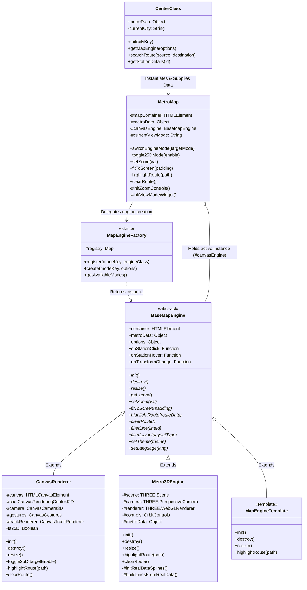

# 🚇 Metro Map Engine - Comprehensive Data Flow, Class Architecture & Pluggable Multi-Engine Blueprint

> **File Location:** `doc/3d_map_doc/MAP_DATA_FLOW_CLASS_AND_EXTENSION_ARCHITECTURE.md`  
> **Status:** Production Architecture Specification & Next-Gen Roadmap (Phases 1–4 Completed)  
> **Target:** Core Development Team & AI Autonomous Agents  
> **Scope:** Full Analysis of `main_project/js/components/map/`, Pluggable Multi-Engine Architecture, Data Flow Diagram, Class Diagram, Three.js Real-Data Pipeline, UI Overlays, and 4th Engine Extension Template.

---

## 1. Executive Summary & Architectural Reality

The Metro Map subsystem is responsible for visualizing complex transit networks, processing user gestures (Pan, Zoom, 360° Orbit, Tilt), displaying multi-strata infrastructure (Underground Tunnels, At-grade Surface, Elevated Viaducts), and interacting with route calculation, station selection, and live telemetry updates.

### What Has Been Achieved (Production Status):
1. **Pluggable Multi-Engine Architecture (Strategy + Factory Pattern):**
   - Built [`BaseMapEngine.js`](../../main_project/js/components/map/core/BaseMapEngine.js) as the unified abstract contract.
   - Built [`MapEngineFactory.js`](../../main_project/js/components/map/core/MapEngineFactory.js) as the dynamic registry supporting `register()`, `create()`, and `getAvailableModes()`.
   - Both `CanvasRenderer.js` (`2d`, `2.5d`) and `Metro3DEngine.js` (`3d`) extend `BaseMapEngine`.
2. **Three.js Pure 3D Engine on Real Transit Data:**
   - 100% disconnected from prototype mock rings.
   - Connected directly to the centralized data pipeline via `metroDataStore.loadCity(city)` in both `index.html` and `3d_preview.html`.
   - Real geographic Lat/Lon coordinates are mapped dynamically into scaled 3D world space with procedural splines (`CatmullRomCurve3`) and elevated viaduct support pillars.
3. **Resilient UI Controls & Platform Sync:**
   - **Persistence Fix:** Eliminated `innerHTML = ""` destructive calls from `destroy()` and `#initCanvas()` in `CanvasRenderer.js`, ensuring `#viewModeWidget` (`[2D] [2.5D] [3D]`) persists permanently across switches.
   - **Fullscreen Toggle Widget (`#btnToggleMapFullscreen`):** Positioned at top-right with CSS-driven SVGs (`maximize-solid-full.svg` ⟷ `minimize-solid-full.svg`).
   - **Capacitor Android APK Support:** Automatically detects native environments (`body.is-capacitor-app`) and injects status bar / notch safe-area spacing (`padding-top: max(48px, env(safe-area-inset-top, 28px))`).
4. **4th Engine Extensibility Template:**
   - Official boilerplate template [`MapEngineTemplate.js`](../../main_project/js/components/map/core/MapEngineTemplate.js) ready for future GIS / Vector Tile engines (e.g. MapLibre GL, Leaflet, OpenLayers).

---

## 2. Master Data Flow Diagram (DFD)

```mermaid
flowchart TD
    %% External Data & Store
    subgraph DataSources["📦 Centralized Data Pipeline (Single Source of Truth)"]
        STORE["metroDataStore (core/metro-data-store.js)<br/>• loadCity(cityKey)<br/>• Deep-merge transit_network + staging_buffer<br/>• Multilingual station names via localeData<br/>• normalizeStationCoordinates()"]
        CENTER_CLASS["CenterClass.js (Mediator)<br/>• Master App State<br/>• RouteFinder & FareCalculator<br/>• City Selection: delhi_ncr, agra, etc."]
    end

    %% Factory & Facade
    subgraph FacadeLayer["🚇 Facade & Pluggable Engine Factory"]
        METRO_MAP["MetroMap.js (Master Facade)<br/>• Top-right View Mode Widget [2D] [2.5D] [3D]<br/>• Top-right Fullscreen Toggle Widget<br/>• 2.5D Camera Controls Panel<br/>• Floating Zoom Controls (+/-/=)"]
        FACTORY["MapEngineFactory.js<br/>• registry.set(key, Class)<br/>• create(key, options)<br/>• getAvailableModes()"]
        CONTRACT["BaseMapEngine.js (Abstract Interface)<br/>• init(), destroy(), resize()<br/>• setZoom(), fitToScreen()<br/>• highlightRoute(), clearRoute()<br/>• onStationClick, onTransformChange"]
    end

    %% Active Engines
    subgraph ActiveEngines["🔌 Registered Pluggable Map Engines"]
        CANVAS_REN["CanvasRenderer.js (2D / 2.5D Mode)<br/>• Dirty-Check Render Loop (0% Idle CPU)<br/>• 360° Bearing & Pitch Matrix (CanvasCamera3D)<br/>• Cubic Bézier Ramps & Soft Shadows (CanvasTrackRenderer)<br/>• 120 FPS Interaction Controller (CanvasGestures)"]
        THREE_ENG["Metro3DEngine.js (3D Game Mode)<br/>• Real Lat/Lon Spline Projection<br/>• Warm CoC Terrain & Soft Shadows<br/>• Elevated Viaduct Deck & Stone Pillars<br/>• Multi-style Elevated & Underground Stations<br/>• OrbitControls with Smooth Damping"]
        TEMPLATE_ENG["MapEngineTemplate.js (4th Engine Slot)<br/>• Boilerplate for Vector GIS / MapLibre"]
    end

    %% UI & Events
    subgraph OverlaysAndEvents["🔔 UI Overlays & Event System"]
        EVENT_BUS["eventBus (core/event-bus.js)<br/>• MAP_TRANSFORM_CHANGED<br/>• ROUTE_SELECTED / ROUTE_CLEARED<br/>• THEME_CHANGED / LANG_CHANGED"]
        STATION_POPUP["StationCalloutView.js<br/>(Interactive Station Card / Route Drafting)"]
        MAP_LEGEND["MapLegend.js<br/>(Physical Layouts, Status, Line Toggles)"]
    end

    %% Data Connections
    STORE -->|"Normalized metroData"| CENTER_CLASS
    CENTER_CLASS -->|"metroData & city"| METRO_MAP
    METRO_MAP --> FACTORY
    FACTORY -->|"Instantiates active engine"| CONTRACT
    CONTRACT <|-- CANVAS_REN
    CONTRACT <|-- THREE_ENG
    CONTRACT <|-- TEMPLATE_ENG

    CANVAS_REN -->|"Station Clicks & Hover"| METRO_MAP
    THREE_ENG -->|"GPU Raycasting Station Click"| METRO_MAP
    METRO_MAP -->|"stationSelected"| CENTER_CLASS
    CENTER_CLASS --> STATION_POPUP

    METRO_MAP --> MAP_LEGEND
    MAP_LEGEND -->|"filterLine / filterLayout"| CONTRACT

    EVENT_BUS <--> METRO_MAP
    EVENT_BUS <--> CONTRACT
```

---

## 3. Comprehensive Class Diagram (UML)



---

## 4. Real Transit Data Pipeline in 3D

`Metro3DEngine` consumes real data provided by `metroDataStore`:

1. **Latitude/Longitude to Centered 3D World Space:**
   Given the geographic bounding box center $(\text{centerLon}, \text{centerLat})$:
   $$\Delta \text{lon} = \text{lon} - \text{centerLon}, \quad \Delta \text{lat} = \text{lat} - \text{centerLat}$$
   $$X_{3D} = \Delta \text{lon} \times 111.32 \times \cos(\text{centerLat} \times \frac{\pi}{180}) \times \text{scale}$$
   $$Z_{3D} = -\Delta \text{lat} \times 110.57 \times \text{scale}$$

2. **Stratum Elevation Levels ($Y_{3D}$):**
   $$Y_{3D} = \begin{cases} 
   +5.2 & \text{Elevated / Viaduct Stations \& Flyovers} \\
   0.0 & \text{At-Grade / Surface Stations} \\
   -4.5 & \text{Underground Tunnels \& Subterranean Depots}
   \end{cases}$$

3. **Smooth Continuous Rail Curves:**
   ```javascript
   const curve = new THREE.CatmullRomCurve3(controlPoints, false, 'catmullrom', 0.2);
   const geometry = new THREE.TubeGeometry(curve, tubeSegments, 0.18, 8, false);
   ```

4. **Dynamic Viaduct Support Pillars:**
   Wherever stations or tracks are elevated ($Y > 1.0$), stone viaduct pillars are loaded and positioned down to ground level ($Y = 0$), establishing structural realism.

---

## 5. UI Controls, Fullscreen & Platform Adaptation

### 5.1 Mode Switcher Persistence Fix (`#viewModeWidget`)
- **Root Cause Identified:** Previously, `CanvasRenderer.destroy()` and `#initCanvas()` called `this.#container.innerHTML = ""`. This destroyed all sibling UI overlays (`#viewModeWidget`, `#zoomControls`, `#map25DControlsPanel`) on mode switch.
- **Permanent Solution:** Replaced `innerHTML = ""` with targeted canvas detachment:
  ```javascript
  // On Init: Mount canvas cleanly behind UI controls
  if (this.#container.firstChild) {
      this.#container.insertBefore(this.#canvas, this.#container.firstChild);
  } else {
      this.#container.appendChild(this.#canvas);
  }

  // On Destroy: Only remove own canvas element
  if (this.#canvas && this.#canvas.parentNode) {
      this.#canvas.parentNode.removeChild(this.#canvas);
      this.#canvas = null;
  }
  ```

### 5.2 Fullscreen Toggle Widget (`#btnToggleMapFullscreen`)
- **Placement:** Docked at the rightmost edge of `#viewModeWidget`.
- **CSS-Driven Dual SVGs:**
  - Normal Screen: `maximize-solid-full.svg`
  - Fullscreen Active: `minimize-solid-full.svg`
- **Native APK vs Mobile Web Adaptation:**
  - **Standard Mobile/Desktop Browsers:** Edge-to-edge 0-gap immersive fullscreen (`100vw × 100vh`).
  - **Capacitor Android APK (`body.is-capacitor-app`):** Automatically injects safe-area padding at the top (`padding-top: max(48px, env(safe-area-inset-top, 28px))`) to protect controls from being clipped by camera notches and system status bars.

---

## 6. How to Add a 4th Map Engine in 3 Simple Steps

Adding a 4th engine (e.g. MapLibre GL for Vector GIS or Leaflet) requires **zero changes to existing business logic**:

### Step 1: Copy Template
Copy [`MapEngineTemplate.js`](../../main_project/js/components/map/core/MapEngineTemplate.js) to your new engine folder:
```javascript
import { BaseMapEngine } from "./BaseMapEngine.js";

export class VectorGisEngine extends BaseMapEngine {
    constructor(container, metroData, options = {}) {
        super(container, metroData, options);
    }
    init() { /* initialize MapLibre / GIS instance */ }
    destroy() { /* cleanup map and listeners */ }
    resize() { /* resize viewport */ }
    setZoom(val) { /* set zoom */ }
    highlightRoute(path) { /* highlight geoJSON layer */ }
    clearRoute() { /* clear highlight */ }
}
```

### Step 2: Register in Engine Factory
```javascript
import { MapEngineFactory } from "./core/MapEngineFactory.js";
import { VectorGisEngine } from "./gis/VectorGisEngine.js";

MapEngineFactory.register("vector-gis", VectorGisEngine);
```

### Step 3: Switch & Use
Call `metroMap.switchEngineMode("vector-gis")`. The UI switcher, route finder, legend filters, and station popups immediately interface with the new engine without modifying a single line of application code.

---

## 7. Verification & Quality Standards

- **Zero Memory Leaks:** Switching between 2D, 2.5D, 3D, and future engines disposes all contexts, buffers, textures, and DOM listeners.
- **Non-blocking Event Signatures:** All engines dispatch the exact same event payloads (`stationId`, `x`, `y`, `lineId`).
- **Syntax Verified:** All files pass strict Node.js syntax checks (`node --check`).
- **Android Synchronized:** All assets and code remain 100% in sync with `android/app/src/main/assets/public/`.
